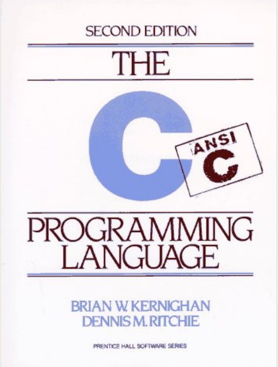

# Playground

个人编程练习仓库，按语言和主题分目录记录学习过程：C / C++、Python、JavaScript / TypeScript、Rust、Lua 以及 LaTeX。

## 目录一览

| 目录 | 内容 |
| --- | --- |
| `C-List/` | 零散的 C 基础练习（变量、标准头文件、等价循环） |
| `Chapter_1_a_Tutorial_Introduction/` | 《The C Programming Language》第 1 章习题 |
| `60questions/` | C 语言入门 60 题，每题一个 `.md` 题目 + `.c` 实现 |
| `Data_Strcture_and_Algorithms/` | 数据结构与算法（C）：数组、链表、栈、队列、二叉树、递归 |
| `高级算法/` | 高级算法片段，如快速平方根倒数 `Q_rsqrt` |
| `C++/` | C++ 入门程序 |
| `Python-List/` | Python 面向对象基础（01–13） |
| `JavaScript-List/` | JavaScript 基础、DOM、异步请求、Vue 待办清单 |
| `TypeScript-List/` | TypeScript 基础类型到函数与接口 |
| `Rust-List/` | Rust 系统学习，每个子目录是一个独立的 Cargo 工程 |
| `lua_Practice/` | Lua 基础语法练习 |
| `Latex-List/` | LaTeX 简历模板 |
| `CommentsDelete/` | 用 C 实现的小工具：删除注释、检查括号匹配 |
| `config/` | clangd 配置示例与 Nerd Font 说明 |
| `assets/` | README 使用的图片资源 |

## C / C++

- `60questions/`：从条件判断、循环到数组、指针、函数的 60 道入门题，题号与源码文件一一对应。
- `Chapter_1_a_Tutorial_Introduction/`：K&R 第 1 章习题，其中 `1.13.Exer_1_1.c` 是完整的单词长度统计直方图。
- `Data_Strcture_and_Algorithms/`：手写数据结构实现，包括数组操作、单链表（带头/不带头结点）、栈、队列、二叉树遍历与递归。
- `高级算法/`：`Q_rsqrt` 为经典的快速平方根倒数实现。
- `CommentsDelete/`：`remove_comments.c` 用状态机删除 C 注释，`syntax_check.c` 用栈检查括号配对。

编译运行单个文件：

```bash
gcc C-List/2_1_direct_compution.c -o demo && ./demo
```

根目录的 `.clangd` / `.cpp.clangd` 供 neovim + clangd 使用；`config/` 下提供了 MSYS2、UCRT64 的配置示例。

## Python

`Python-List/` 按顺序记录面向对象的学习，建议按编号阅读：

| 文件 | 主题 |
| --- | --- |
| `01_class_definition.py` | 类与对象基础 |
| `02_no_init.py` | 不使用 `__init__` 的类 |
| `03_init.py` | `__init__` 方法 |
| `04_class_attribute.py` | 类属性 |
| `05_self.py` | `self` 的含义 |
| `06_private_attributes.py` | 私有属性 |
| `07_property.py` | `property` 属性 |
| `08_inheritance.py` | 继承 |
| `09_super.py` | `super()` |
| `10_polymorphism.py` | 多态 |
| `11_class_methods.py` | 类方法 |
| `12_static_methods.py` | 静态方法 |
| `13_decorator.py` | 装饰器 |

```bash
python Python-List/03_init.py
```

## JavaScript / TypeScript

`JavaScript-List/` 按学习阶段分目录：

- `000/`：`for` / `while` 循环基础。
- `001/`：`let` / `const`、数据类型、运算、`console` / `alert`、条件与循环、DOM 选择与文本操作。
- `002/`：函数、参数与返回值，数组 `push` / `pop` / `shift` / `includes` / `indexOf`，`forEach` / `map` / `filter` / `find` 与链式调用。
- `003/`：`setTimeout`、回调地狱、`Promise`、`then` / `catch`、`async` / `await`、`fetch` 以及天气小应用、五子棋等综合页面。
- `NOW/`、`NOW-Copy/`：Vue 待办清单与错误处理等后续练习。

HTML 页面直接用浏览器打开即可；TypeScript 文件可用 `npx tsc` 编译或 `npx ts-node` 运行（编译产物 `ts*.js` 已被忽略）。

`TypeScript-List/` 覆盖基础类型、数组与元组、`any` / `unknown`、`void` / `null` / `undefined` / `never`、类型推断、联合类型、字面量类型、类型别名、函数类型、可选参数与默认参数、函数重载、接口。

## Rust

`Rust-List/` 中每个目录都是一个独立 Cargo 工程，目录名带章节编号：

| 编号 | 主题 |
| --- | --- |
| 01–02 | 入门与变量 |
| 11–18 | 数据类型、常量、变量遮蔽 |
| 21–23 | 算术、比较、逻辑运算 |
| 41–44 | 数组、越界检查、切片、`Vec` |
| 51–54 | 函数、表达式与语句、返回值、发散函数 |
| 61–65 | 条件、`if let`、`loop` / `while` / `for` |
| 71–75 | 所有权、移动与克隆、借用 |
| 81–84 | 生命周期与省略规则 |
| 91–96 | 结构体、枚举、方法 |
| 101–105 | 模式匹配与 `Option` |
| 111–114 | `Result`、`unwrap` / `expect`、错误传播、`panic!` |
| 121–124 | 泛型函数、结构体、枚举与方法 |
| 131–134 | trait、默认实现、trait 参数与派生 |
| 141–144 | 闭包、捕获、迭代器与适配器链 |
| 151–154 | 智能指针、递归类型、引用计数、内部可变性 |
| 161–163 | 模块系统、`use`、Cargo |
| 171–173 | `Vec`、`HashMap`、`HashSet` |
| 181–183 | 并发：`spawn`、`mpsc`、`Mutex` |
| 191–194 | `Display` / `Debug`、`Drop`、`From` / `Into`、`anyhow` / `thiserror` |
| 201–203 | 宏、`unsafe`、`async` / `await` |

```bash
cd Rust-List/hello-world-01
cargo run
```

## Lua

`lua_Practice/` 从条件分支、循环、函数、`local` 作用域一路练到综合应用：

```bash
lua lua_Practice/01_if_then_else_elseif_end.lua
```

## LaTeX

`Latex-List/Resumes/teacher/` 是一份中文简历模板，推荐使用 XeLaTeX 构建：

```bash
cd Latex-List/Resumes/teacher
latexmk -xelatex main.tex
```

## 说明

- 仓库中的代码以练习和记录为主，不追求工程化封装。
- `.gitignore` 会忽略无扩展名文件、`*.exe` / `*.out`、名称包含 `test` 的文件、`*.Exer` 以及 TypeScript 编译产物 `ts*.js`，因此编译输出不会进入版本库。


